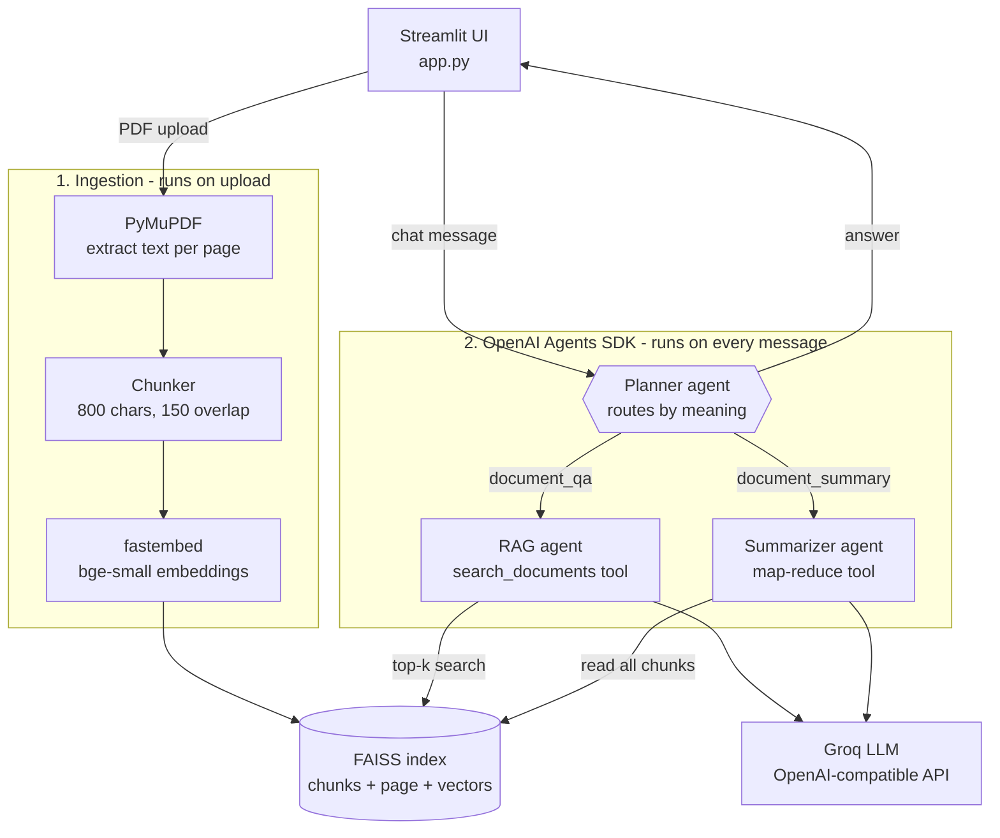

# 📚 DocMind Agents

Chat with multiple PDFs. A **planner agent** built on the **OpenAI Agents SDK** reads each message and decides on its own which specialist agent to use: a **RAG agent** for questions, or a **summarization agent** for summaries. There are no mode buttons.

**Live demo:** https://docmind-agents.streamlit.app/
Sample PDFs for testing are in the `data/` folder.

## Architecture



**Two flows**

1. **Ingestion (on upload):** PDF → text per page → overlapping chunks → local embeddings → FAISS index. Large PDFs are processed page by page and embedded in batches, with a progress bar.
2. **Chat (every message):** the planner LLM reads the message and calls one tool: `document_qa` (RAG agent) or `document_summary` (summarizer agent). The chosen agent's answer is returned as is.

## How the agents work

| Agent                      | Job                            | How                                                                                                                                                                                                                                                      |
| -------------------------- | ------------------------------ | -------------------------------------------------------------------------------------------------------------------------------------------------------------------------------------------------------------------------------------------------------- |
| **Planner**          | Decide who handles the message | Both agents are wrapped with `Agent.as_tool()`. The LLM picks a tool from the tool descriptions and instructions. No keyword rules in code.                                                                                                            |
| **RAG agent**        | Answer questions from the PDFs | `search_documents` tool embeds the query and fetches the top-k chunks from FAISS. Chunks below a relevance threshold are dropped. The agent answers only from the passages, with `(file, page)` citations. If nothing relevant is found, it says so. |
| **Summarizer agent** | Summarize one or all PDFs      | `summarize_documents` tool runs **map-reduce**: summarize each ~10k-character section, then merge the partial summaries in batches until one remains.                                                                                            |

## Features

- Upload multiple PDFs, including large ones (up to 200 MB each).
- Intent detection with no manual mode selection.
- Answers cite the file name and page.
- Fallback when the documents do not contain the answer.
- Live progress: indexing progress bar and a status box showing what the agents are doing.
- Chat history is kept per session, so follow-up questions work.
- Duplicate uploads are skipped; same-named different files are kept apart.
- LLM and model are set by environment variables (Groq by default, any OpenAI-compatible provider works).

## Tech stack

| Part            | Choice                                                                             |
| --------------- | ---------------------------------------------------------------------------------- |
| Agent framework | OpenAI Agents SDK (`openai-agents`)                                              |
| LLM             | Groq via its OpenAI-compatible API (default `openai/gpt-oss-120b`, configurable) |
| PDF extraction  | PyMuPDF                                                                            |
| Embeddings      | `fastembed` with `BAAI/bge-small-en-v1.5` (local, free)                        |
| Vector DB       | FAISS (`IndexFlatIP`, exact cosine search)                                       |
| UI              | Streamlit                                                                          |

## Project structure

```
app.py                      Streamlit UI only
config.py                   all settings, read from environment variables
core/
  pdf_loader.py             PDF bytes -> pages
  chunker.py                recursive splitting with overlap
  vector_store.py           embeddings + FAISS index + search
  ingest.py                 upload -> searchable pipeline
  llm.py                    connects the Agents SDK to Groq
pdf_agents/
  context.py                shared run context (vector store + progress callback)
  rag_agent.py              RAG agent + search_documents tool
  summarizer_agent.py       summarizer agent + map-reduce tool
  planner_agent.py          planner agent, routes to the two agents
tests/test_pipeline.py      offline tests (no API key needed)
data/                       sample PDFs
```

The AI logic (`core/`, `pdf_agents/`) knows nothing about Streamlit, so the UI can be swapped without touching the agents.

## Run locally

```bash
python -m venv .venv
.venv\Scripts\activate          # Windows  (Mac/Linux: source .venv/bin/activate)
pip install -r requirements.txt
copy .env.example .env          # Mac/Linux: cp .env.example .env
```

Put your key in `.env` (free key: https://console.groq.com/keys):

```
LLM_API_KEY=your_groq_key
LLM_MODEL=openai/gpt-oss-120b
```

```bash
streamlit run app.py
pytest -q                       # offline tests
```

The first run downloads the small embedding model (about 130 MB).

## Deploy (Streamlit Community Cloud)

1. Push the repo to GitHub.
2. On share.streamlit.io: New app, select the repo, main file `app.py`.
3. Advanced settings: Python 3.12, and in Secrets add:

```toml
LLM_API_KEY = "your_groq_key"
LLM_MODEL = "openai/gpt-oss-120b"
```

## Design decisions

- **Agents as tools, not handoffs:** the planner stays in control and the specialists return their result. This matches the brief ("agents instantiated as tools, planner decides").
- **Planner returns the tool result as is** (`tool_use_behavior="stop_on_first_tool"`): no extra LLM rewrite, so answers are never cut or altered.
- **FAISS flat index:** exact search, in memory, no server. Simple and fast enough for this scale.
- **Local embeddings:** free, no extra API key, and independent of the LLM provider.
- **Map-reduce summaries:** a long PDF cannot fit in one prompt. For very large documents at most 10 evenly spaced sections are summarized, and the answer says so.
- **Anti-hallucination layers:** a relevance threshold, a strict "answer only from passages" prompt, low temperature, and citations.

## Known limitations

- Scanned (image-only) PDFs are not supported (no OCR).
- The index lives in memory per session, so a refresh or app restart clears uploaded files.
- One tool per message: a request that mixes a summary and a question is handled by the first tool only.
- Free Groq tiers have rate limits; the client retries automatically, and the model can be changed with `LLM_MODEL`.
